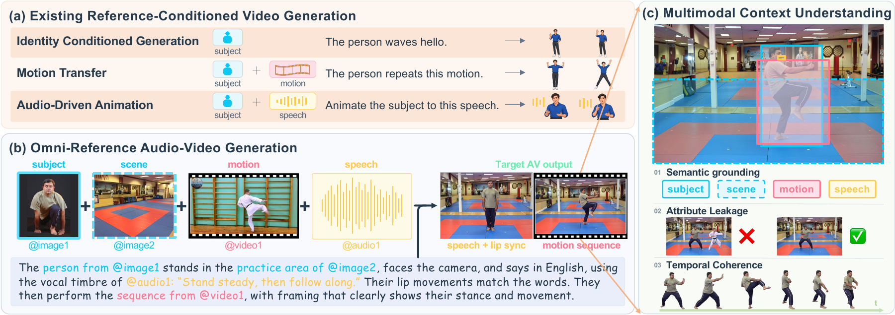
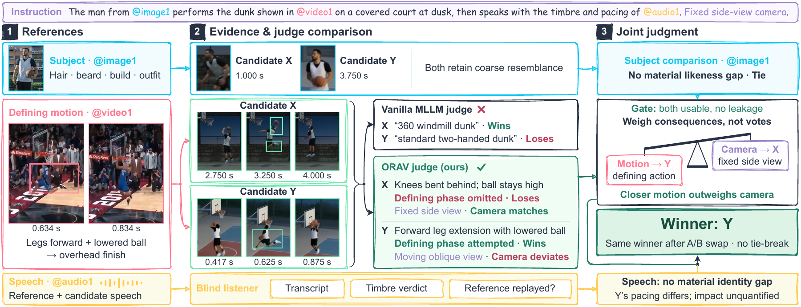

<p align="center"></p>

<h1 align="center">ORAV Bench</h1>

<p align="center"><strong>Benchmarking Audio-Video Generation from Multimodal Contexts</strong></p>

<p align="center">Jiacheng Hua<sup>1,2</sup>, Xiaokun Feng<sup>2</sup>, Jiaqi Hua<sup>1</sup>, Chang Liu<sup>1</sup>, Yilin Wang<sup>1</sup>, Biao Wang<sup>2,†</sup>, Miao Liu<sup>1,‡</sup></p>

<p align="center"><sup>1</sup> College of AI, Tsinghua University    <sup>2</sup> Tencent Hy</p>

<p align="center"><sup>†</sup> Project lead    <sup>‡</sup> Corresponding author</p>

<p align="center"><a href="https://arxiv.org/abs/2609.34843"></a> <a href="LICENSE"></a> <a href="#quick-start"></a></p>

<p align="center"><a href="https://arxiv.org/abs/2609.34843">Paper</a>  ·  <a href="#quick-start">Quick start</a>  ·  <a href="#evaluation">Evaluation</a>  ·  <a href="#pointwise-diagnostics">Diagnostics</a>  ·  <a href="#contributing-model-outputs">Contribute</a>  ·  <a href="#citation">Citation</a></p>

## Overview

**ORAV Bench** evaluates **Omni Reference Audio-Video Generation**: producing one coherent audio-video event from an instruction and heterogeneous image, video, and audio references. The instruction determines which properties each reference should contribute, how they bind to the output, and which source content should be excluded.

**380 tasks · 2–10 references per task · 9 semantic roles · 30 role compositions**

<p align="center">  </p>

This repository provides the **evaluation pipeline**: reference-aware pairwise judging, system ranking, and pointwise diagnostics. The Judge achieves **86.08% effective agreement** with human judgments on a **10% held-out subset** of the benchmark. Benchmark tasks and model generations are released separately: [ORAV-Bench](https://huggingface.co/datasets/ORAV-Bench/ORAV-Bench) and [ORAV-Bench-Artifacts](https://huggingface.co/datasets/ORAV-Bench/ORAV-Bench-Artifacts).

| Reference modality | Semantic roles                              |
| ------------------ | ------------------------------------------- |
| Image              | `subject`, `prop`, `scene`, `style` |
| Video              | `motion`, `camera_movement`, `vfx`    |
| Audio              | `speech`, `music`                       |

## Evaluation

ORAV evaluates the contribution of each reference within the complete requested event. A visually blind Listener provides auditory evidence; the Judge compares that evidence with timestamped visual panels in both presentation orders.

**Demonstration.** In the illustrated case, Y realizes the defining motion more closely, while X better matches the camera. ORAV prefers Y based on its contribution to the complete instruction.

<p align="center">  </p>

| Entry point          | Purpose                                                                     |
| -------------------- | --------------------------------------------------------------------------- |
| `orav prepare`     | Prepare full-duration media proxies and timestamped panels for inspection   |
| `orav evaluate`    | Run the Listener and Judge, preserving requests, responses, and comparisons |
| `orav rank`        | Report system ranking and confidence intervals                              |
| `orav diagnostics` | Measure quality, reference affinity, and speech independently of the Judge  |

## Quick start

Use **Python 3.11 or 3.12**, with **FFmpeg 5.1+ (including libx264) and ffprobe** available on `PATH`:

```bash
git clone https://github.com/Tencent-Hunyuan/ORAV-Bench.git
cd ORAV-Bench
python -m venv .venv
source .venv/bin/activate
python -m pip install -e .
orav --help
```

Download the tasks and the model outputs you want to compare. This example selects two models and downloads the exact benchmark revision recorded in the artifacts' `benchmark.json`. The `data/` directory is ignored by Git.

```bash
python -m pip install huggingface_hub
python - <<'PYDATA'
import json
from pathlib import Path
from huggingface_hub import snapshot_download

artifacts = Path(snapshot_download(
    repo_id="ORAV-Bench/ORAV-Bench-Artifacts", repo_type="dataset",
    local_dir="data/artifacts",
    allow_patterns=["benchmark.json", "kling-v3-omni/*", "minimax-h3/*"],
))
binding = json.loads((artifacts / "benchmark.json").read_text())
snapshot_download(
    repo_id=binding["repo_id"], repo_type="dataset",
    revision=binding["revision"], local_dir="data/benchmark",
)
PYDATA
python scripts/build_manifest.py --tasks data/benchmark/tasks.json --generations data/artifacts/kling-v3-omni/manifest.json data/artifacts/minimax-h3/manifest.json --output runs/example/manifest.json
```

Task prompts remain in `tasks/<task_id>/prompt.en.txt` and `prompt.zh.txt`. References are resolved within each task folder; output videos are resolved within each model folder. The join verifies the task definitions and English prompts against the artifacts' input fingerprint.

```text
data/
  benchmark/
    tasks.json
    tasks/<task_id>/
      prompt.en.txt
      prompt.zh.txt
      refs/...
  artifacts/
    benchmark.json
    <model_id>/
      manifest.json
      videos/<task_id>.mp4
```

For your own model, create a distinct model folder and record its generation settings and task status in `manifest.json`, for example:

```json
{"config": {"model": "my-model"}, "completed": ["subject-motion-7f681a"], "failed": []}
```

Save each completed output as `videos/<task_id>.mp4`; omit unsubmitted tasks from both lists. Add the new manifest to `--generations` and use a new evaluation output directory. For results in another directory, copy the matching root `benchmark.json` there. The join maps unavailable candidates to `null` and never substitutes old outputs. You can also supply an evaluation manifest directly using [examples/manifest.json](examples/manifest.json); its paths are relative to the file. All paths in that example are illustrative.

Set the evaluator model names and endpoints in [examples/evaluation.json](examples/evaluation.json). `judge` and `listener` select entries from `models`; each entry configures its own API model and credentials. The Judge supports Responses, Chat Completions, or Gemini; the Listener uses Gemini audio input.

Set the corresponding environment variables and run evaluation and ranking:

```bash
# Base URLs include the API prefix; credentials are read from the environment.
export ORAV_ASTRA_BASE_URL='https://YOUR-JUDGE-HOST/v1'
export ORAV_ASTRA_API_KEY='YOUR-JUDGE-KEY'
export ORAV_GEMINI_BASE_URL='https://YOUR-LISTENER-HOST/v1beta'
export ORAV_GEMINI_API_KEY='YOUR-LISTENER-KEY'

# Optional: prepare and inspect media before any API calls.
orav prepare runs/example/manifest.json --config examples/evaluation.json --output runs/example
orav evaluate runs/example/manifest.json --config examples/evaluation.json --output runs/example --workers 8
orav rank runs/example/comparisons.json --output runs/example/ranking.json
```

The output includes visual panels, auditory evidence, ordered judgments, fused comparisons, and source identities. Ranking uses shared-delivery instances by default. Ties, order conflicts, unavailable responses, and insufficient evidence remain distinct in the comparison records.

For a Chat Completions judge, select `"judge": "chat-judge"`, replace its `model`, and set `ORAV_CHAT_BASE_URL` and `ORAV_CHAT_API_KEY`. It must support images and JSON Schema outputs. Per-model rate limits, timeouts, and output budgets are set in the same configuration file.

Reuse an output directory to resume identical requests, including cached failures. To reevaluate from scratch, choose a new empty output directory; there is no `--force` flag. Changed inputs, evaluator settings, or code require a new directory. Use one process per output directory and `--workers` for concurrency. Ranking counts order conflicts as ties by default; `--exclude-conflicts` removes them. Use `--role motion` for a role-conditioned ranking or `--no-audio-reference` for tasks without audio references. Role-conditioned rankings compare complete tasks carrying that role.

## Pointwise diagnostics

```bash
python -m pip install -e '.[diagnostics]'
# Install the selected families' dependencies and set local asset paths first.
orav diagnostics run runs/example/manifest.json --config examples/diagnostics.json \
  --metrics visual speech audiobox --device cuda:0 --output runs/diagnostics
orav diagnostics summarize runs/example/manifest.json runs/diagnostics \
  --output runs/diagnostics-summary.json
```

Before running, set local asset paths in [examples/diagnostics.json](examples/diagnostics.json) and install the selected families' dependencies; some families also require the upstream source checkout. Asset paths are relative to the configuration file. Compatible model checkpoints are accepted without requiring a particular revision or checksum. Runs record the actual assets and package versions for traceability and cache identity. See [third-party notices](THIRD_PARTY_NOTICES.md) for upstream components and license notes.

Available families: `visual`, `vbench`, `dover`, `aesthetic`, `audiobox`, `speech`, `music`, `nisqa`, `face`, `style`, `motion`, and `localization`. Choose only the families you need; their measurements remain separate from ORAV preferences and ranking.

CER/WER additionally requires `diagnostics.speech_target` in each applicable evaluation-manifest task. Localization requires `diagnostics.reference_scope`, mapping subject/prop reference handles to object categories, as illustrated in [examples/manifest.json](examples/manifest.json). These annotations are optional and are not supplied to the Judge or Listener. Use a separate diagnostics output directory when changing assets or environment; reuse it to resume an identical configuration.

The implementation lives in `orav_bench/`: media and manifest handling, API clients, Listener/Judge execution, protocol, ranking, and diagnostics. Offline checks are in `tests/`; install `.[dev]`, then run `ruff check .` and `pytest`.

## Contributing model outputs

We welcome generation results from model providers and community contributors. Please use the original benchmark prompts and references, preserve task IDs, and include generation settings and failures in the manifest. To contribute, [email the maintainers](mailto:hjc21@mails.tsinghua.edu.cn) with the model name and a download link to outputs in the [Artifacts format](https://huggingface.co/datasets/ORAV-Bench/ORAV-Bench-Artifacts).

## Citation

```bibtex
@article{hua2026orav,
  title   = {ORAV: Benchmarking Audio-Video Generation from Multimodal Contexts},
  author  = {Hua, Jiacheng and Feng, Xiaokun and Hua, Jiaqi and Liu, Chang and
             Wang, Yilin and Wang, Biao and Liu, Miao},
  journal = {arXiv preprint arXiv:2609.34843},
  year    = {2026},
  url     = {https://arxiv.org/abs/2609.34843}
}
```

Machine-readable citation metadata is available in [CITATION.cff](CITATION.cff).

## License and contact

Original ORAV code is licensed under [Apache-2.0](LICENSE). Third-party implementations, model weights, APIs, and media retain their respective terms; see [THIRD_PARTY_NOTICES.md](THIRD_PARTY_NOTICES.md).

For questions, contact [Jiacheng Hua](mailto:hjc21@mails.tsinghua.edu.cn) or [Miao Liu](mailto:miaoliu@mail.tsinghua.edu.cn).
